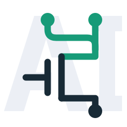
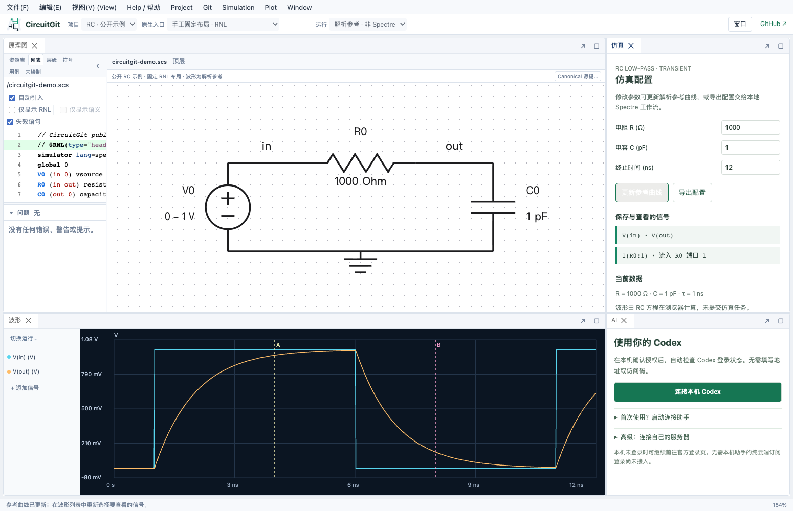

<p align="center"></p>

<h1 align="center">CircuitGit</h1>
<p align="center"><strong>AI-native circuit design, versioned on GitHub.</strong></p>
<p align="center"><a href="https://joshuazeng713.github.io/CircuitGit/"><strong>Open workbench ↗</strong></a> · <a href="docs/getting-started.md">Get started</a> · <a href="docs/remote-node.md">Connect your Codex node</a> · <a href="README.zh-CN.md">中文介绍</a></p>

CircuitGit brings schematics, text netlists, simulation configurations, waveforms, and circuit revision history into one workbench. AI agents can use the same engineering tools through MCP; Git records reviewable source and configuration changes.

The interface builds on [Rich Netlist](https://github.com/rich-netlist/rnl), with movable, closable Dockview panels for schematics, simulation, waveforms, AI, and version history.

## Try it

**[joshuazeng713.github.io/CircuitGit](https://joshuazeng713.github.io/CircuitGit/)**

The GitHub Pages demo runs entirely in your browser. Drag panel tabs, float and return windows, inspect a fixed-layout RC schematic, select voltage/current probes, pan and zoom waveforms, and export a simulation configuration with its netlist.

The demo waveforms are explicitly labeled **analytical RC references**, calculated in the browser. Opening the website does not contact your local machine or start an AI model or Spectre job.

For real AI conversations, choose **连接本机 Codex** in the AI panel and approve the local connection window. The connector checks Codex's existing login and reports the account/plan only when Codex supplies it. If Codex requires sign-in, a separate button opens the official login URL returned by Codex. No address or access code is needed in this flow.

Start the local helper once per computer session: on macOS, double-click **Start CircuitGit.command** in the downloaded repository (requires Python 3.10+, Git and Codex). The helper stays on your computer while you use the lightweight website. Self-hosted server URL/code entry remains under **Advanced**. See [connection setup](docs/remote-node.md).

The RC canvas remains a demo while AI reads the selected node project. This release does not import desktop windows, offer public subscription OAuth, or grant model access independently of the node. Real circuit changes and simulations retain the existing human-review workflow.



## What is included

| Capability | Implementation |
|---|---|
| Circuit viewing | RNL Viewer and its WebAssembly renderer; preserved schematic positions and wiring when exported geometry is supplied |
| Simulation workflow | Versioned configuration → reviewed changes → plan/preflight → Spectre submission → result collection → GitHub archive |
| Waveform analysis | Saved transient voltage/current signals, exact probe mappings, cursors, smooth pan/zoom, and display decimation |
| Circuit version control | Design-scoped diffs and history, reviewable commits, and restoration as a new change |
| AI integration | MCP tools and interactive resources; web chat through an explicitly authorized owner node, with models, settings, images and sessions |
| Workspace | Rearrangeable, closable, floating panels with layout persistence |

## Run locally

Requires Python **3.10+** and Git. The basic web/gateway build uses Python's standard library; Node **22+** is used for JavaScript tests. The optional SDK MCP adapter has its own dependency file.

```bash
git clone https://github.com/joshuazeng713/CircuitGit.git
cd CircuitGit
python3 -B tools/workbench/launch.py
```

Open **http://127.0.0.1:8766/**. A PDK-free RC project is included. Configure `config/site.local.json` with your own SSH/Cadence installation before requesting a simulation. Licensed Cadence tools, PDKs, AI access, and accounts are supplied by the operator.

To preview the static demo without a gateway:

```bash
python3 -B tools/dev/build_pages.py
python3 -m http.server 8765 --bind 127.0.0.1 --directory site
```

Open **http://127.0.0.1:8765/**. See [setup and deployment](docs/getting-started.md) for agent connections, configuration, and operating boundaries.

## Repository map

```text
apps/web/       browser workbench, public demo, pinned RNL/Dockview assets
apps/codex/     CLI, plugin, MCP tools/resources, optional web AI bridge
apps/mcp/       optional official-SDK MCP transport
modules/        shared schematic, simulation, waveform and workspace logic
contracts/      public tool and context contracts
tools/          local gateway, runners, exporters, builds and checks
projects/       redistributable circuit examples (RC)
config/         portable configuration examples; local overrides are ignored
docs/           architecture, usage, branding and third-party provenance
tests/          unit, browser and integration tests
```

Application source was extracted from the working IC on GitHub project. Private native circuit archives, site-specific configuration, PDK/model dependencies, runtime conversations, and historical simulation archives are not included in this public repository. Some retained integration tests and engineering notes describe that earlier checkout; see [release scope](docs/public-release.md).

## Development

```bash
python3 -B tools/dev/build.py all
python3 -B tools/dev/check_structure.py
node --test tests/demo/*.test.mjs tests/context/*.test.mjs tests/waveforms/*.test.mjs
node --test tests/remote/*.test.mjs
python3 -B tests/remote/test_node.py
```

Edit source under `apps/` and `modules/`; `web/`, `site/`, and `dist/` are generated. Pushing `main` rebuilds and deploys the Pages demo using [GitHub Actions](.github/workflows/pages.yml).

## Credits and license

CircuitGit is MIT licensed. Third-party components retain their original licenses and attribution, including **Rich Netlist**, **Dockview**, and bundled fonts. See [THIRD_PARTY_NOTICES.md](THIRD_PARTY_NOTICES.md). CircuitGit is an independent project and is not affiliated with Cadence, GitHub, or OpenAI.
