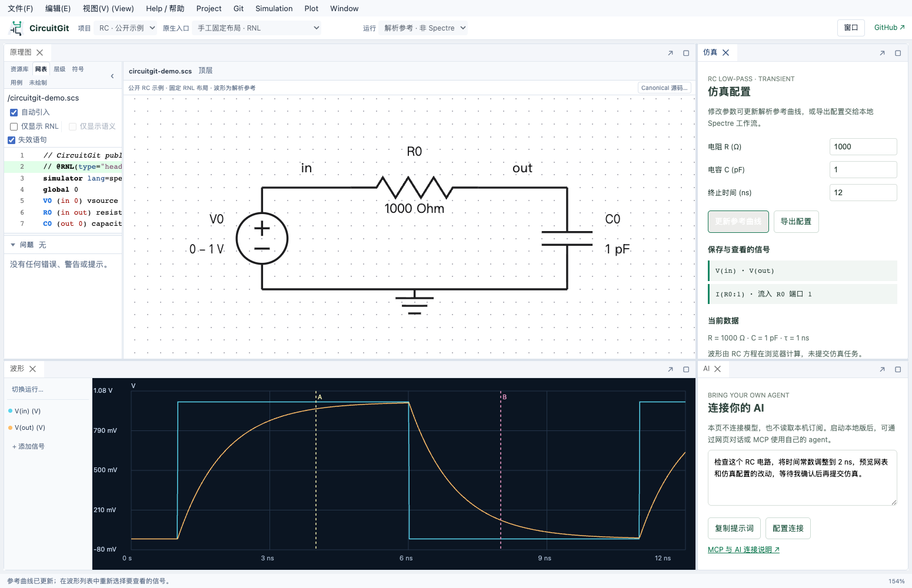

<p align="center"></p>

# CircuitGit

**AI 原生电路设计，让每一次电路修改都能在 GitHub 上追踪。**

**[打开网页演示 ↗](https://joshuazeng713.github.io/CircuitGit/)** · [安装与连接](docs/getting-started.md) · [English](README.md)

CircuitGit 把原理图、文本网表、仿真配置、波形和电路版本管理放进同一个工作台。界面在 Rich Netlist Viewer 上扩展，通过 Dockview 将原理图、仿真、波形、AI 和版本管理窗口自由排列、浮动和关闭。

- **电路作为代码管理**：网表与配置可查看差异、提交和恢复；修改和仿真输入可以关联到具体版本。
- **保留原理图布局**：导入包含位置、方向和走线的几何数据，避免只靠网表自动排版。
- **可复现的仿真流程**：配置 → 审阅 → 计划与预检查 → Spectre 提交 → 收集结果 → GitHub 归档。
- **交互波形**：已保存的电压与端口电流、节点探针、游标，以及缩放/平移时的抽样绘制。
- **AI 工具接口**：通过 MCP 提供项目读取、受控修改、仿真和结果访问，也保留本地网页 AI 对话入口。



## 网页演示能做什么

打开 [GitHub Pages 演示](https://joshuazeng713.github.io/CircuitGit/) 后，可拖动窗口、查看固定布局的 RC 原理图，在 Plot 菜单选择探针，再点击节点或 R0；波形支持滚轮缩放、拖动平移和游标。仿真面板可调整参数并导出网表与 JSON 配置。

**示例波形是浏览器计算的 RC 解析参考，不是 Spectre 运行结果。** GitHub Pages 不运行 AI 后端或 Cadence，也不会自动访问本机账号。完整功能需要运行本地工作台，并连接自己的 AI agent 与授权 Cadence 环境。

## 本地运行

```bash
git clone https://github.com/joshuazeng713/CircuitGit.git
cd CircuitGit
python3 -B tools/workbench/launch.py
```

需要 Python 3.10+ 与 Git。打开 `http://127.0.0.1:8766/`。首次启动生成被 Git 忽略的本地配置，提交仿真前需填写自己的 SSH、Spectre 和 OCEAN 路径。

本公开仓库包含应用源码、构建工具、MCP 插件、通用导出/仿真工具及 RC 示例。原先工程中的私有电路档案、PDK、服务器配置和运行记录留在原工程中；详见 [发布范围](docs/public-release.md)。

## 致谢

基于 [Rich Netlist](https://github.com/rich-netlist/rnl) 和 Dockview 等开源组件。项目采用 MIT 许可证，第三方代码及字体保留各自许可证和署名，详见 [第三方说明](THIRD_PARTY_NOTICES.md)。
