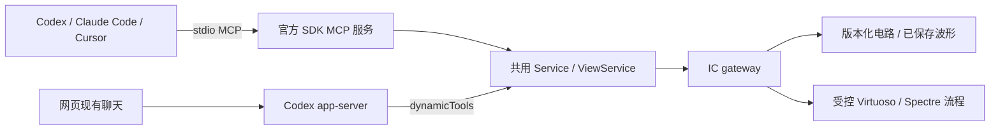

# AI 与 MCP 连接

现有网页聊天走 `/api/ai/* → Codex app-server → dynamicTools → Service → IC gateway`。已有 Codex 插件走 stdio MCP，直接复用同一 Service。只读 Dockview 预览中的 AI 是明确标注的界面 fixture，没有模型连接。

仿真面板中的环境/PDK、测试平台和诊断辅助入口复用这个 AI 对话。点击后展开 AI 面板，将当前 intake、修订、源码或运行身份随问题加入输入框；已有草稿和图片保留，由用户检查后发送。尚未连接或没有选中的会话时，问题会留待连接或选择会话，不自动启动第二个 Agent。返回的 `ic_*` 工具结果通过已有 onboarding synchronizer 更新同一个仿真页面。SpiceOwl 提供直接 Python SDK 供工作台调用，无需另配一个 SpiceOwl MCP 聊天通道；独立 Codex 插件和通用 MCP 工具入口仍保留各自用途。

GitHub Pages 在线入口现已增加**单用户运行节点**连接：`在线网页 → HTTPS 节点 /api/ai/* → 同一 Codex app-server adapter → IC gateway`。用户填写节点 URL 和节点访问码并明确授权后，才读取工程及会话；没有自动本机探测或订阅 OAuth。节点可以运行在自己的服务器上，凭据留在节点，网页访问码仅驻留内存。该入口不开放开发者模式，保留电路人工审批。详见 [在线节点配置](remote-node.md)。

默认用户入口现为 **连接本机 Codex**：固定本机助手弹窗确认 → 临时浏览器授权 → 官方 `account/read` 检查。地址/访问码已收进高级设置。尚未登录时可通过 `account/login/start(type=chatgpt)` 打开官方返回的登录页，等待对应 `loginId` 的完成回执；不读取认证文件、不替换已有模型服务、不将 OpenAI token 传给网页。首次需要运行本机助手；这与面向公众的纯网站 OAuth 是两个独立流程。

真实网页入口为已配置 AI adapter 的网关上的 `/studio/dockview/index.html`，例如本机 `http://127.0.0.1:8766/studio/dockview/index.html`。从当前 checkout 启动：`python3 tools/workbench/launch.py --config /absolute/workbench.local.json --port 8766`。更新已有服务前先检查运行回合和待审批请求；同一 runtime 只能有一个网关进程。`tests/studio/dockview-browser.mjs --serve` 是只读测试预览，拒绝 POST，不能用于聊天。

网页回合保留用户问题和精确工程身份，只附带有限的几何摘要，避免完整渲染载荷超过 app-server 输入上限。源码版本、哈希、未保存修改、模型提供方及手动审批检查仍然执行。摘要不能作为节点映射或几何一致性证明；详细源码需通过工具读取。失败会保留结构化方法和错误码及原回执，网页不自动重新提交请求。

app-server 在同一回合内通知 `error.willRetry=true` 时，网页显示“模型连接重试中”，保持计时并锁定发送与模型选择，等待最终 `turn/completed`。模型目录可读不代表每个模型都有可用推理通道；模型服务繁忙、通道不可用和本地事件连接中断分别显示。

确认是已结束的模型服务故障且没有未决审批时，输入区提供 **恢复输入 / 更换模型**。该按钮保留历史、失败回合和当前草稿，恢复后由用户选择模型并发送新消息，不重发旧请求、不自动切换模型。`POST /api/ai/resume` 必须携带明确的 `session_id` 和当前失败回合的 `expected_turn_id`，服务端重新核对终态证据。权限拒绝、人工中止、未知结果、运行中任务或缺少证据的旧会话不能通过此入口恢复。

输入框旁的齿轮设置按钮可展开 **模型**、**思考强度** 和 **操作权限**，收起时在按钮提示中保留当前选择。输入框随内容扩展至四行，超过后滚动。强度按模型目录提供的档位生成；“沿用会话”不覆盖当前 app-server 线程设置，“模型默认”会明确使用该模型目录报告的默认值。切换到不支持所选强度的模型时，保留选择并要求重选。`POST /api/ai/turn` 的可选 `reasoning_effort` 分别对应省略/null、`model_default` 或目录中的实际值，明确选择通过原生 `turn/start.effort` 传递；这记录的是提交设置，不是对模型内部计算量的测量。

操作权限支持默认的 `manual`（人工批准）与 `read_only`（只读）。只读回合只允许项目、源码、已有结果、审批回执读取，以及不带 `run_id` 的本地任务列表；生成差异审阅、计划、远端检查、提交、收集和归档均由服务端拒绝。人工批准沿用原有受控操作与审批流程，两种模式都不开放原生 shell 或文件写入。设置随每个回合冻结，运行、审批和未知结果期间不能修改；权限拒绝会暂停后续工作。网页不修改本机 Codex 的全局权限或推理配置。

可选的 `developer`（开发者模式）用于开发工作台程序自身。管理员在网页 AI 的本地配置中指定 `development_workspace`，指向应用源码 checkout；`development_access` 可设为 `manual`（默认）或 `full`（完全访问），无效值会禁用开发者模式。`GET /api/ai/development` 返回可用性、工作目录与 `access`，缺少有效配置时开发者选项不可用。浏览器不能提交或替换这些配置，发送前会重新读取；目录或权限改变会保留草稿，要求核对后重新发送。目录显示在设置中，与页面当前电路工程的 runtime 分支和源版本分开。

开发者回合使用该目录作为原生 Codex 工具的初始工作目录。`manual` 保持只读沙箱及人工审批；需要越过沙箱的操作在网页中显示具体请求，供用户单次批准。用户明确启用 `full` 后，新线程使用 `sandbox: danger-full-access`、`approvalPolicy: never`，原生命令、文件修改和联网不再逐项审批；完全访问的文件权限不限于初始目录。服务端核验实际返回的沙箱、审批策略和目录，无法满足时停止，不伪造批准、不静默降级，也不改全局 Codex 配置。普通模式与 `ic_*` 电路工具保留原有审批链。

每回合记录 `development_access`；旧回执缺少该字段时仍按 `manual` 理解。进入、退出开发者模式或改变开发权限时建立新的临时模型线程，并保留有界历史作为参考，不重放旧任务或批准。开发参考在 `apps/codex/prompts/developer.md`。用户要求前端更新时可以直接构建到当前 checkout 的 `web/` 并验证在线资产，无需独立管理会话。后端重启须避开正在承载的活动回合及待审批请求，保存并核对恢复状态。

2026-11-14 本机实测：在真实 Dockview 输入框按 Enter，通过当前配置模型得到“连接正常。”；四个面板加载正常，回合完成，无待审批或浏览器错误。本次仅验证聊天连通，没有修改电路或发起新仿真。

现在增加一个使用官方 Python MCP SDK 的独立入口。任何支持本地 stdio MCP 的 agent 客户端都可以配置它；项目操作不依赖 Codex app-server。已有插件及 Python 3.9 零依赖 CLI 继续保留。



MCP 提供工具、资源和交互请求，不能单独替代聊天会话协议。若要在网页内切换 agent，后续接入层适合采用 ACP：由工作台管理聊天流、取消和会话，由 agent 通过 MCP 调用 IC 工具。此次没有将网页聊天切换成 ACP，也没有安装 Claude Code 或 Cursor，不能把协议测试写成这些客户端的真实运行验证。

## 可选独立包

开发者构建 `python3 -B tools/dev/build.py mcp`，生成 `dist/ic-workbench-mcp/`。其中 `server.py` 使用官方 SDK，`backend/` 复用原有完整服务、UI 资源和执行器；包内不包含工程、结果、私有配置或虚拟环境。构建不安装依赖、不启动模型或网关。

使用 Python 3.11+ 的独立环境按包内 `requirements.lock` 安装依赖，或按 [SDK 入口说明](../apps/mcp/README.md) 准备环境。首次准备后，将该环境的 Python 路径、包内 `server.py` 和以下其中一个参数加入 agent 的 MCP 配置：

- `--config /absolute/client.json`：连接已经管理好的本地网关。
- `--settings /absolute/settings.json`：复用现有 PluginRuntime 的按需网关启动和状态检查。

agent 会自动启动这个 stdio 子进程，日常使用不需要先在 Terminal 运行 Python。不能给 stdio 填网页 URL；本版尚未开放 MCP HTTP 端口。SDK 的通用跨平台能力不代表已有 POSIX 工程执行器已验证支持 Windows。

Help → **AI / MCP 连接**先展示本机 Codex 检测和账号状态；下方独立折叠区生成通用 JSON 或 Codex TOML。网页聊天不要求复制 MCP 配置。生成配置不等于连接成功；未配置时禁用复制。对话框不修改任何 agent 的全局配置。

## 本机 Codex 发现与账号检查

打开上述菜单会自动读取 `GET /api/ai/discovery` 和现有网页会话列表。检测运行于工作台后台所在主机，按显式 `codex_bin`、绝对 PATH 目录、已知官方桌面应用位置查找程序。显式配置无效时会停止，不自动改选其他程序；未配置时支持独立 CLI 和 Codex/ChatGPT 桌面内置程序。发现接口仅检查文件，不启动进程、不读取认证文件、不扫描端口。

选择一个空闲网页会话，点击 **连接并读取账号**。`POST /api/ai/connect` 只接受 `{ "session_id": "..." }`，通过该会话所属 app-server 查询 `account/read`、配置中的有限状态字段、模型目录，以及适用时的 `account/rateLimits/read`。该操作可能启动本机 app-server，但不创建模型回合、不登录或刷新令牌。运行中、暂停、待审批或结果未知的会话不能借此恢复。已完成且尚无 RPC 的恢复会话需要选择新的空闲会话；正常聊天仍使用原有会话生命周期。

界面分别显示登录类型、官方返回的套餐、配额窗口占用率、默认模型、审批状态和历史推理记录。未返回的套餐/用量保持未知；API Key 或第三方 provider 不推定拥有某种 ChatGPT 订阅。配额窗口不是账单、余额或订阅到期日。目录可读、历史回合成功都不保证下一次模型调用可用。

此版本不检测桌面进程是否运行，也不接管桌面现有会话；桌面窗口无需保持打开。其他 agent 的账号适配尚未实现，不使用 MCP 代替各自的登录和对话协议。未登录时请在官方 Codex 中登录后重查。明确非人工审批策略会阻止后续模型发送，原有人工审批检查保持有效。

现有本机/开源 app-server 路线与公开托管网站应区分。根据官方文档，托管或商业服务应使用获准的 Sign in with ChatGPT 集成，不能把本机已有登录直接当作公共网站的订阅接口。

相关官方接口：[app-server](https://learn.chatgpt.com/docs/app-server)、[Codex MCP server 移除说明](https://learn.chatgpt.com/docs/mcp-server)、[Sign in with ChatGPT](https://developers.openai.com/siwc)。

可在本地 AI client 配置中添加以下可选字段，以便页面读取启动信息。所有路径均需要换成已经存在的绝对路径；它不包含密钥，也不改变聊天模型或已有审批策略：

```json
{
  "mcp_connection": {
    "python": "/absolute/isolated-environment/bin/python",
    "server": "/absolute/ic-workbench-mcp/server.py",
    "config": "/absolute/client.json"
  }
}
```

使用插件配置时将 `config` 字段替换为 `settings`。`GET /api/ai/connection` 只返回经过筛选的非秘密路径和连接类型，不会启动 agent、探测账号或返回完整配置。网页与 agent 的现有登录方式分别保留。

## 多 agent 与审批边界

同一用户的 agent 可以显式使用同一个状态目录，共用冻结请求和视图修订。锁和 CAS 用于防止并发覆盖，持久化回执用于防止重复派发。这是同一用户的本地信任域，不是不同用户之间的认证隔离。

MCP 变更工具仍先准备请求，由 `ic_request_review` 请求宿主人工表单。客户端没有 form elicitation 支持、取消、断开或超时，请求保持未批准，不自动重放。界面资源和普通工具兼容是分开的；能调用工具不等于客户端支持 MCP Apps 或已经显示了原理图窗口。

## 验证与来源

隔离测试由 `tests/mcp/` 覆盖官方 ClientSession 与实际 stdio 子进程的握手、工具/资源与元数据一致性，以及审批、超时和取消行为。网页配置生成测试位于 `tests/studio/agent-connections.test.mjs`。`tests/architecture/mcp_live.py` 单独读取已存在项目和波形；只有其成功报告才能证明真实数据链路通过。测试不自动运行模型、提交仿真或批准实际工程请求。

2026-11-13 核对的上游实现与官方文档：

- [官方 MCP Python SDK](https://github.com/modelcontextprotocol/python-sdk)，MIT；本入口的精确依赖版本、文件哈希和许可记录在 `apps/mcp/dependency-provenance.json`。
- [Codex MCP 配置](https://learn.chatgpt.com/docs/extend/mcp?surface=cli)。
- [Claude Code MCP 配置](https://code.claude.com/docs/en/mcp)。
- [Cursor MCP 配置](https://cursor.com/docs/mcp)。
- [ACP 协议](https://agentclientprotocol.com/get-started/introduction)与 [官方 Python SDK](https://github.com/agentclientprotocol/python-sdk)，作为后续可替换聊天层的候选。
